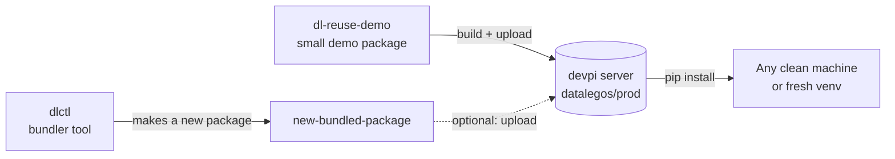
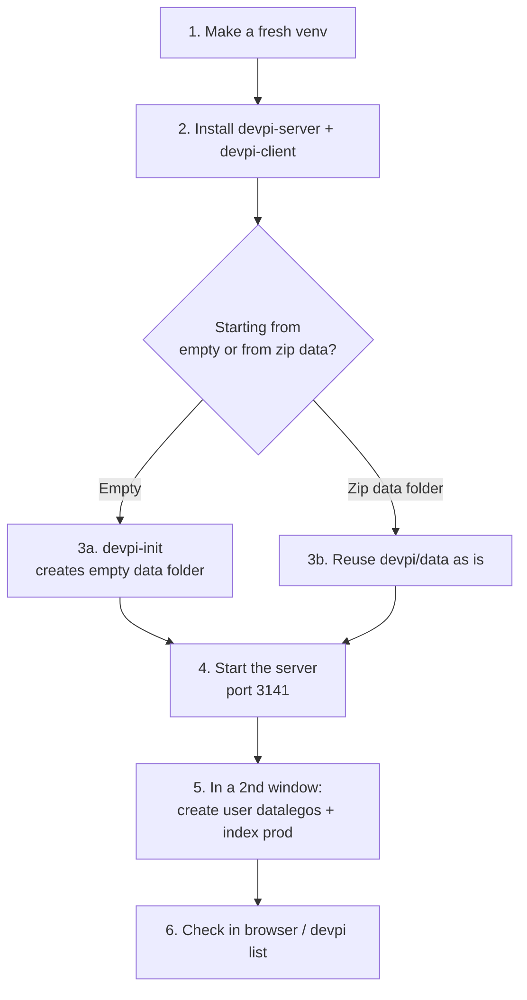

# 01 — devpi (your private package shop)

## What is it?

devpi is a small server that runs on your own computer. Think of it as a **private PyPI**: you upload your own Python packages to it, and later `pip` installs them from it.

In your zip, the shop already has an index called **`datalegos/prod`** with these packages inside:

| Package | Versions inside |
|---|---|
| `dl_reuse_demo` | 1.0.0 (wheel + tar.gz) |
| `bug_lifecycle_engine` | 1.0.0 (wheel + tar.gz), 1.0.1 (py311 wheel) |

## The big picture (all 3 zips together)



## Flow of this zip



## Folder map (what is inside the zip)

| Folder | What it is | Do you need it? |
|---|---|---|
| `devpi/data` | The shop's storage (packages + database) | **Yes** — this is the real content |
| `devpi/devpi-env` | Python environment with devpi installed | No — recreate it (see note) |
| `devpi/test-env`, `devpi/poc-test-env` | Test environments used to try `pip install` | No — recreate when needed |

> **Note:** Windows virtual environments remember the exact folder where they were made (yours was `D:\devpi\...`). If you move them, they break. So always create a **new** venv instead of reusing the zipped ones.

## Step by step (Windows, PowerShell)

Starting point: an empty folder, for example `D:\work\devpi`. Python 3.11 installed.

### Step 1 — Make a fresh environment
```powershell
cd D:\work\devpi
py -3.11 -m venv devpi-env
devpi-env\Scripts\activate
```
**Check:** your prompt now starts with `(devpi-env)`.

### Step 2 — Install devpi
```powershell
pip install devpi-server devpi-client
```
**Check:** `devpi-server --version` and `devpi --version` both print a version. (The zip used server 6.20.3 and client 7.3.0.)

### Step 3 — Choose your data folder
- **Option A — truly empty:** `devpi-init --serverdir data` creates a new empty shop.
- **Option B — keep what you had:** copy the `data` folder from the zip into `D:\work\devpi\data`. It is already initialised, so skip `devpi-init`.

### Step 4 — Start the server
```powershell
devpi-server --serverdir data
```
Leave this window **open**. The server is running while it is open.

**Check:** open `http://localhost:3141` in a browser. You should see the devpi page.

### Step 5 — Create the user and index (only for Option A)
Open a **second** PowerShell window, activate the same venv, then:
```powershell
devpi use http://localhost:3141
devpi user -c datalegos password=ChooseAPassword
devpi login datalegos --password=ChooseAPassword
devpi index -c prod bases=root/pypi
```
`bases=root/pypi` means: if a package is not in your private index, devpi will fetch it from the public PyPI. Leave it out if you want a fully closed shop.

For Option B, the user and index already exist. If you do not remember the password, use Option A instead.

### Step 6 — Check that everything works
```powershell
devpi use http://localhost:3141/datalegos/prod
devpi list
```
**Check:** with Option B you see `dl_reuse_demo` and `bug_lifecycle_engine`. With Option A the list is empty until you upload something (see guide 02).

You can also open `http://localhost:3141/datalegos/prod/+simple/` in the browser.

## Quick check list

- [ ] Server window is open and shows no red errors
- [ ] `http://localhost:3141` opens in the browser
- [ ] `devpi use http://localhost:3141/datalegos/prod` works
- [ ] `devpi list` shows what you expect

## Common problems

| Problem | Fix |
|---|---|
| Browser cannot open `localhost:3141` | Server window was closed. Start it again (Step 4). |
| `devpi login` fails | Wrong password. Create a new user (Step 5). |
| Venv from the zip will not start | Expected. Create a new venv (Step 1). |
| Port 3141 already in use | Start with another port: `devpi-server --serverdir data --port 3142`, and use that port everywhere. |
