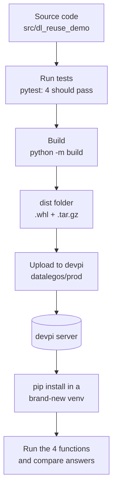

# 02 — dl-reuse-demo (the small demo package)

## What is it?

A tiny Python package with only **4 functions**. Its job is to prove one thing: *"I can build a package, put it in my private devpi shop, and install it on another machine with pip."*

| Module | Functions |
|---|---|
| `text_utils` | `normalize_text`, `count_words` |
| `math_utils` | `calculate_total`, `calculate_average` |

It has no outside dependencies, so nothing can go wrong from the internet side.

## Flow of this zip



## Folder map

| Item | Meaning |
|---|---|
| `pyproject.toml` | Package name, version (1.0.0), needs Python 3.11 or newer |
| `src/dl_reuse_demo` | The actual code |
| `tests/test_utils.py` | 4 small tests, one per function |
| `dist/` | Already-built files (wheel and tar.gz). You can rebuild them. |

## Before you start

Guide **01** must be finished: the devpi server is running and the `datalegos/prod` index exists.

## Step by step (Windows, PowerShell)

Starting point: an empty folder, for example `D:\work\demo`. Unzip `dl-reuse-demo.zip` there.

### Step 1 — Fresh environment
```powershell
cd D:\work\demo\dl-reuse-demo
py -3.11 -m venv .venv
.venv\Scripts\activate
```

### Step 2 — Run the tests
```powershell
pip install -e ".[dev]"
pytest
```
**Check:** the last line says `4 passed`.

### Step 3 — Build the package
```powershell
pip install build
python -m build
```
**Check:** the `dist` folder has two files: `dl_reuse_demo-1.0.0-py3-none-any.whl` and `dl_reuse_demo-1.0.0.tar.gz`.

### Step 4 — Upload to devpi
```powershell
pip install devpi-client
devpi use http://localhost:3141/datalegos/prod
devpi login datalegos --password=YourPassword
devpi upload --from-dir dist
```
**Check:** `devpi list dl-reuse-demo` shows version 1.0.0.

If the same version already exists (it does in your zip's data), devpi refuses to overwrite it. Change `version` in `pyproject.toml` (for example to 1.0.1), rebuild, upload again.

### Step 5 — Install it like a stranger would
Make a **new, empty** environment so nothing is borrowed from your work folder:
```powershell
cd D:\work
py -3.11 -m venv consumer-env
consumer-env\Scripts\activate
pip install dl-reuse-demo --index-url http://localhost:3141/datalegos/prod/+simple/
```
**Check:** pip says `Successfully installed dl-reuse-demo-1.0.0`.

### Step 6 — Use it and compare the answers
```powershell
python -c "from dl_reuse_demo.math_utils import calculate_average; print(calculate_average([1.0, 2.0, 3.0]))"
```
Expected answers for the 4 functions:

| Call | Expected |
|---|---|
| `normalize_text("  Hello   World  ")` | `hello world` |
| `count_words("Hello World")` | `2` |
| `calculate_total([1.0, 2.0, 3.0])` | `6.0` |
| `calculate_average([1.0, 2.0, 3.0])` | `2.0` |

## Quick check list

- [ ] `pytest` shows 4 passed
- [ ] `dist` has the wheel and the tar.gz
- [ ] `devpi list dl-reuse-demo` shows the version
- [ ] A brand-new venv can `pip install` it from devpi
- [ ] The answers match the table

## Common problems

| Problem | Fix |
|---|---|
| `Connection refused` on upload or install | devpi server is not running. See guide 01, Step 4. |
| `Python 3.11 required` | Use `py -3.11`. The package needs 3.11 or newer. |
| `409` or "already exists" on upload | That version is already in the shop. Bump the version and rebuild. |
| pip cannot find the package | Check the index URL ends with `/+simple/` and the name is `dl-reuse-demo`. |
