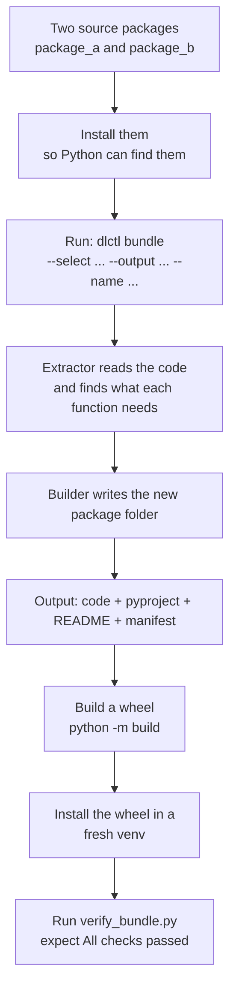
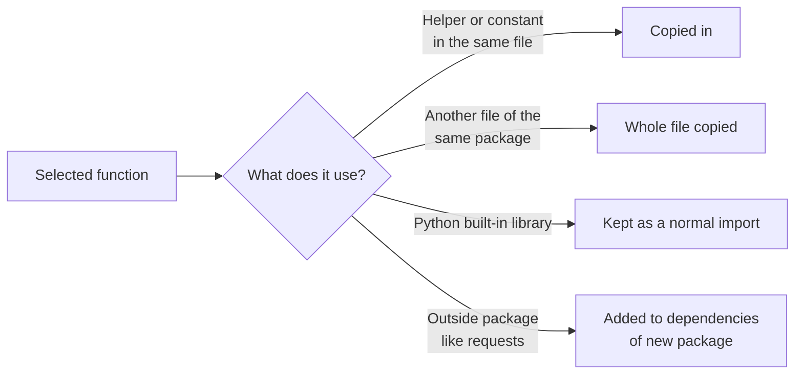

# 03 — dlctl (the function bundler tool)

## What is it?

`dlctl` is a command-line tool. You tell it: *"I want only these functions from these packages."* It then creates a **new small package** that contains just those functions, plus whatever they need to work.

Example in your zip: it takes `function_a` from `package_a` and `function_x` from `package_b`, and makes `new-bundled-package`.

## Flow of this zip



## What the tool decides for you



## Folder map

| Item | Meaning |
|---|---|
| `pyproject.toml` | Defines the `dlctl` command |
| `src/dlctl/cli.py` | The command you type |
| `src/dlctl/extractor.py` | The "reader": works out what each function needs |
| `src/dlctl/builder.py` | The "writer": creates the new package |
| `tests/package_a`, `tests/package_b` | Two dummy packages used as practice input |
| `tests/new-bundled-package` | Example of what the tool produced |
| `tests/verify_bundle.py` | Final check script |

## Step by step (Windows, PowerShell)

Starting point: an empty folder, for example `D:\work\dlctl`. Unzip `dlctl-package.zip` there.

### Step 1 — Fresh environment
```powershell
cd D:\work\dlctl\dlctl-package
py -3.11 -m venv .venv
.venv\Scripts\activate
```

### Step 2 — Install the tool
```powershell
pip install -e .
```
**Check:** `dlctl --help` shows the list of commands, including `bundle`.

### Step 3 — Install the two practice packages
The tool finds code by importing it, so the sources must be installed first.
```powershell
pip install -e tests\package_a -e tests\package_b
```

### Step 4 — Create the bundle
Delete the old example folder first if you want to see it created fresh: `tests\new-bundled-package`.
```powershell
dlctl bundle `
  --select package_a.module_a:function_a `
  --select package_b.module_b:function_x `
  --output tests\new-bundled-package `
  --name new-bundled-package `
  --version 0.1.0
```
**Check:** the screen ends with a summary: 2 functions, 0 external deps, 1 sibling copy, then `Done.`

The new folder must contain `src`, `pyproject.toml`, `README.md` and `dlctl_manifest.json`. The manifest is the receipt: it lists every choice the tool made.

### Step 5 — Build the wheel
```powershell
pip install build
python -m build tests\new-bundled-package --outdir tests\dist
```
**Check:** `tests\dist\new_bundled_package-0.1.0-py3-none-any.whl` exists.

### Step 6 — Test in a clean environment
```powershell
cd D:\work\dlctl
py -3.11 -m venv fresh-venv
fresh-venv\Scripts\activate
pip install dlctl-package\tests\dist\new_bundled_package-0.1.0-py3-none-any.whl
python dlctl-package\tests\verify_bundle.py
```
**Check:** you must see exactly:
```
[PASS] function_a result looks correct
[PASS] function_x result looks correct
All checks passed.
```
This proves the new package works **without** package_a or package_b being installed. That is the whole point of the tool.

## Quick check list

- [ ] `dlctl --help` works
- [ ] The bundle command ends with `Done.`
- [ ] Output folder has the manifest
- [ ] Wheel file exists in `tests\dist`
- [ ] In a clean venv, verify script prints `All checks passed.`

## Optional: send the bundle to devpi
Same as guide 02, Step 4: `devpi upload --from-dir tests\dist`.

## Common problems

| Problem | Fix |
|---|---|
| `dlctl` is not recognised | Venv not activated, or Step 2 skipped. |
| Error "module not found" on `--select` | Step 3 skipped. Install the source packages first. |
| Spec format error | Must be `module.path:function_name`, with a colon. |
| Warnings in the output | The tool found name clashes or cross-package links. Read them in the manifest. |
| Known tool limit | The generated `README.md` shows `from new-bundled-package import ...`. A hyphen is not valid in Python. The correct import is `from new_bundled_package import ...`. |
